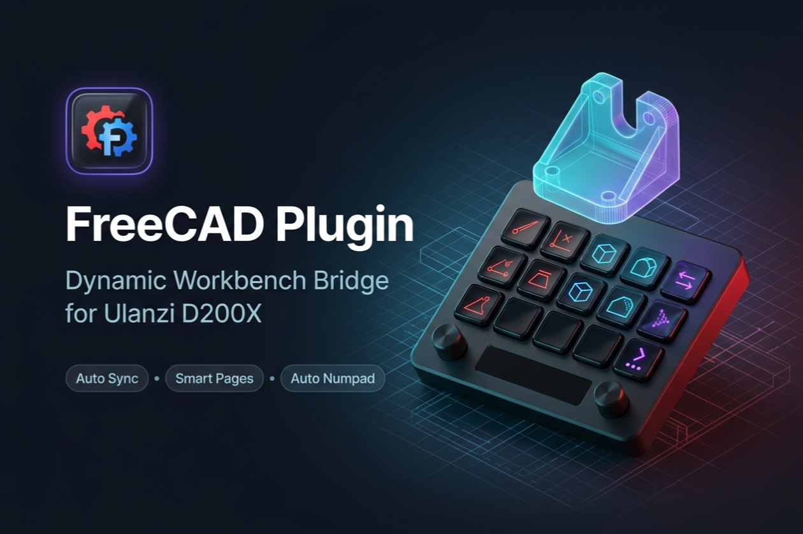

# FreeCAD Dynamic Bridge for Ulanzi D200X



Turn your **Ulanzi D200X** into a context-aware CAD control console for **FreeCAD** (`0.21`, `1.0`, and `1.1+`) on **macOS** and **Windows**.

Keys and icons automatically adapt in real time to your active FreeCAD workbench, Sketcher geometry selection, and numeric input dialogs — running **100% locally** over `127.0.0.1` with zero cloud dependencies or telemetry.

---

## Key Features

- **Automatic Workbench Sync** — Instantly switches all 13 dynamic keys and icons when changing between **Core / General**, **Part Design**, **Sketcher**, and **Part** workbenches.
- **Smart Multi-Page Navigation** — Dedicated pagination key (Slot 13) with live dot indicators (`• •` / `• • •`):
  - **Part Design:** `PD` (core modeling) + `PD+` (binders, boolean, loft, pipe, helix, draft, datum plane)
  - **Sketcher:** `Sketch` (drawing) → `Constr` (constraints) → `Tools` (transform & extra constraints)
- **Context-Aware Sketcher Switching** — Automatically jumps from `Sketch` to `Constr` when you select sketch geometry, and returns to `Sketch` when selection clears.
- **Automatic Numeric Keypad (Numpad)** — Whenever a FreeCAD numeric dialog or task panel opens (Pad, Pocket, Dimension, Fillet, etc.), the D200X automatically transforms into a 3×3 Numpad (`0–9`, auto-detected `.`/`,` decimal separator, `Backspace`, and `Tab` to cycle fields).
- **107 Verified FreeCAD Commands** — Includes compatibility handling across FreeCAD `0.21`, `1.0`, and `1.1+` (including `Sketcher_ConstrainCoincidentUnified`, `Sketcher_Projection`, `Std_DrawStyle`, camera toggles, and on-demand workbench loading).
- **Ready-to-Use Profile & 1-Click Bridge Installer** — Ships with a pre-configured `FreeCAD.ulanziDeckProfile` (with CPU/RAM/GPU monitor & encoder) and a built-in installer button inside the Property Inspector.
- **Bilingual UI** — Full English (`en`) and Portuguese (`pt_PT`) localization.

---

## Requirements

- **Ulanzi Studio** `3.0.11` or newer
- **Ulanzi D200X** (or compatible Keypad device)
- **FreeCAD** `0.21`, `1.0`, or `1.1+`
- **macOS** `10.15+` or **Windows** `10+`

---

## Quick Setup

1. **Install the Plugin** in **Ulanzi Studio** (from the Marketplace, Community Store, or by downloading `com.ulanzi.freecad.ulanziPlugin.zip` from [Releases](https://github.com/KennyKoyama/com.ulanzi.freecad.ulanziPlugin/releases)).
2. **Select any `FreeCAD Dynamic Slot` key** on your FreeCAD profile in Ulanzi Studio.
3. In the Property Inspector panel, click **"Install / Update FreeCAD Bridge"**.
   - This copies `InitGui.py` and `ulanzi_bridge.py` into your FreeCAD `Mod/UlanziBridge` directory.
4. **Restart FreeCAD.**
5. Open FreeCAD — Ulanzi Studio automatically switches to the FreeCAD profile and syncs your D200X keys in real time.

> **Tip:** In **Key Behavior → Mode**, keep **Automatic** for dynamic workbench layouts + pagination, or switch to **Custom** to pin specific FreeCAD commands per workbench on individual keys.

---

## Privacy & Security

- The FreeCAD Bridge binds **strictly to loopback (`127.0.0.1:19876`)**.
- Rejects cross-origin browser requests (`Origin` header check against CSWSH) and external `Host` headers (DNS rebinding protection).
- Strict command-name allowlist validation (`^[A-Za-z0-9_]{1,100}$`) and RFC 6455 frame limits.
- Zero external network requests, zero analytics, zero telemetry.

---

## Building Locally

```bash
make package
```

Or manually:

```bash
(cd com.ulanzi.freecad.ulanziPlugin && npm ci --omit=dev)
zip -r com.ulanzi.freecad.ulanziPlugin.zip com.ulanzi.freecad.ulanziPlugin \
  -x "*/.DS_Store" "*/__pycache__/*" "*/store-assets/*" "*/.git/*"
```

---

## License

MIT — see [LICENSE](LICENSE).
